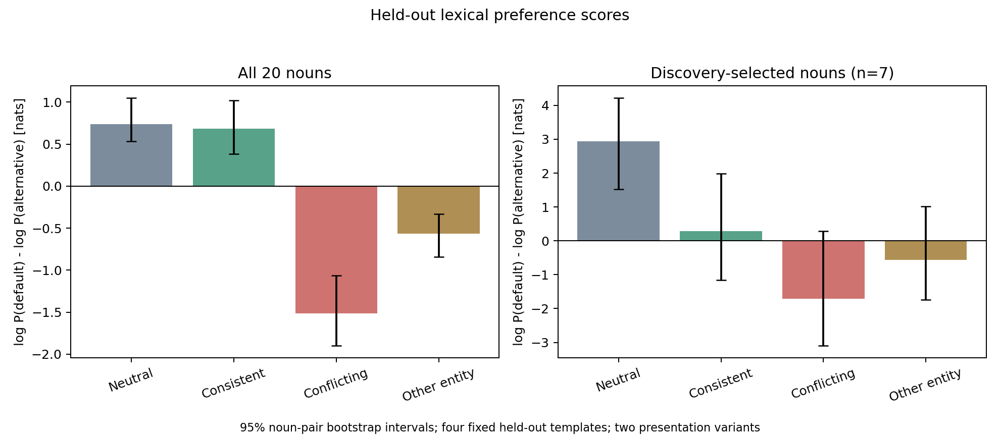

# Lexicon pilot results

Completed October 15, 2026 on the 23,000-step `babistories-12L768d` checkpoint. The pilot provides evidence for noun-sensitive food associations and partially entity-specific contextual effects. It does not establish a separate lexical knowledge store or locate the responsible parameters. Large effects from information about the other character, and sensitivity to presentation order, make a clean interpretation as entity-specific updating premature.

## Design and validation

The [plan](PLAN.md) was recorded before evaluation. The frozen model scored 1,280 prompts and 2,560 full candidate continuations: 20 animal nouns, eight templates, four conditions, and two presentation variants. Four templates selected associations; the remaining four evaluated them. Animal pairs used the same foods in reversed candidate orientations to control generic candidate preference. Each noun had one proposed food association.

The checkpoint has 12 layers, 12 heads, 768 dimensions, 2,688 persistent slots per head, and approximately 123.59 million parameters. CPU float32 inference used one thread and took 714 seconds including loading and validation. Batched candidate scores agreed with the original forward method and individual-example scoring within 0.000011 nats, including a multi-token completion. Exact provenance is in [metadata.json](results/2026-10-15/metadata.json).

## Stable associations

Seven of 20 nouns had positive neutral scores on every discovery template after averaging presentation variants: rabbit, squirrel, cow, penguin, bear, mouse, and butterfly.

Six of those seven met the descriptive held-out confirmation rule: a positive neutral mean and at least three of four positive template means. Cow did not confirm. It remains in the selected analysis because selection used discovery data only. Failure of this screen means the proposed food contrast was not robust under these frames; it does not establish absence of lexical knowledge for that animal.

All ten animal pairs had positive pair-averaged neutral scores on held-out templates. Averaging reversed food contrasts reduces the explanation that the model simply prefers one food word independently of the animal. This is evidence of noun-sensitive associations within the tested stimulus design, not proof of semantic understanding or a distinct knowledge base.

## Contextual effects

D is `log P(proposed default) - log P(alternative)` in nats. Positive values favor the default. These are likelihood contrasts, not unconstrained prediction accuracy.

| Held-out condition | All 20 nouns | Seven discovery-selected nouns |
| --- | ---: | ---: |
| Neutral | 0.740 | 2.942 |
| Consistent preference about target | 0.685 | 0.280 |
| Conflicting preference about target | -1.514 | -1.705 |
| Same conflicting preference about companion | -0.563 | -0.556 |

For the selected nouns, the fraction of held-out prompts favoring the default was 87.5% in neutral, 55.4% in consistent, 26.8% in conflicting, and 41.1% in other-entity contexts.

| Contrast | All nouns, mean and 95% interval | Selected nouns, mean and 95% interval |
| --- | --- | --- |
| Target override: conflicting minus neutral | -2.254 [-2.887, -1.675] | -4.647 [-6.739, -2.620] |
| Companion shift: other minus neutral | -1.303 [-1.673, -0.971] | -3.498 [-5.111, -1.902] |
| Entity specificity: conflicting minus other | -0.951 [-1.379, -0.523] | -1.149 [-1.716, -0.622] |

Intervals use 5,000 bootstrap resamples of animal pairs and condition on the fixed templates and selected set. There are ten clusters in the all-noun analysis and seven in the selected analysis. They do not capture selection uncertainty or establish vocabulary-wide generalization.

The negative entity-specificity contrast supports a greater alternative shift when the preference belongs to the queried animal. However, the large companion shift shows substantial cross-entity influence. Neutral prompts also lack the food mentions present in the preference statements, so neutral-to-context shifts combine contextual updating with mention and wording effects. The conflicting-versus-other comparison is better matched.

## Presentation order diagnostic

This diagnostic was added after observing the unexpectedly weak consistent condition. The original selection and primary comparisons were unchanged.

Variant 0 introduces the target first and states “loved X and disliked Y”. Variant 1 introduces the target second and states “disliked Y and loved X”. The two order changes are coupled, so this pilot cannot attribute effects specifically to recency, negation processing, or introduction order.

| Selected-noun held-out score | Variant 0 | Variant 1 |
| --- | ---: | ---: |
| Neutral | 3.453 | 2.430 |
| Consistent | -1.732 | 2.291 |
| Conflicting | -1.107 | -2.303 |
| Other entity | 0.387 | -1.499 |
| Entity specificity | -1.494 | -0.804 |

The consistent condition changes sign across variants, while entity specificity keeps the same direction. The data support partial entity sensitivity alongside strong presentation effects. They do not support claiming that the model cleanly preserves defaults whenever only the companion's preference changes.

## Interpretation and next experiment

The first behavioral prerequisite is partly met: several proposed associations generalize across templates, and predictions depend on which animal receives contextual information. The second prerequisite needs better controls: context does not update only the intended entity, and consistent information can weaken a default substantially.

Before localizing memory components, independently cross character-introduction order and food-mention order. Compare the existing liked/disliked statements with affirmative-only constructions and balanced food mentions. Keep the original evaluation set separate from this follow-up. This would distinguish entity binding from order and negation effects more clearly. No follow-up model run or internal intervention has been performed here.

## Saved artifacts

- [Exact prompts and full candidate scores](results/2026-10-15/scores.csv)
- [Per-noun screening and contrasts](results/2026-10-15/screening.csv)
- [Machine-readable summary and order diagnostic](results/2026-10-15/summary.json)
- [Condition figure](results/2026-10-15/conditions.png) and [vector version](results/2026-10-15/conditions.svg)
- [Per-noun figure](results/2026-10-15/per_noun.png)
- [Reproduction instructions](README.md)

Small artifacts are preserved in this repository as well as in scratch. The checkpoint was read without modification.
